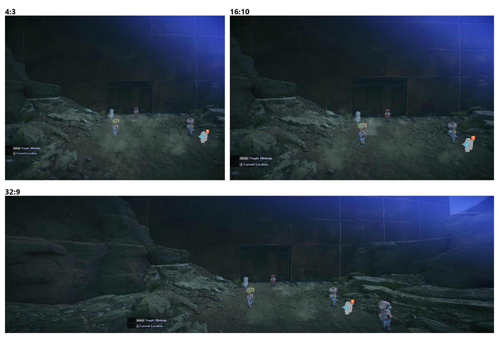

# STAR-OCEAN-THE-SECOND-STORY-R-Any-Aspect-Ratio

 

Works with the full game and the Steam demo.

## 1. Install

Extract the ZIP into the game folder, beside `SO2R.exe` (demo: `SO2R_Demo.exe`).

## 2. Optional: SteamOS / Proton / Winlator

Launch option: `WINEDLLOVERRIDES="winmm=n,b" %command%`

On Winlator, add the environment variable `WINEDLLOVERRIDES` with value `winmm=n,b`.

## 3. Custom Aspect Ratio

Edit `Width` and `Height` in `[Resolution]` in `SO2R_ARFix.ini`. The default is
1280x800 (16:10, Steam Deck). Any size works, and the game's Window setting
(Windowed, Borderless, Fullscreen) is kept. For Borderless or Fullscreen, use
your screen resolution. `Width = 0` and `Height = 0` use the resolution selected
in the game's Display Settings.

The 3D view fills the whole screen: taller screens (16:10, 4:3) show more above
and below, wider ones (21:9, 32:9) show more to the sides. The game's black
letterbox bars are removed; the black bars of story events stay. Menu artwork
keeps its original shape.

On macOS (CrossOver), `Width` and `Height` are replaced by the display size.

## 4. Field of View

`Multiplier` in `[FOV]` scales the camera field of view (default 1.0, range 0.5
to 2.0). Higher values show more of the scene.

Check `SO2R_ARFix.log` if the fix does not load.
