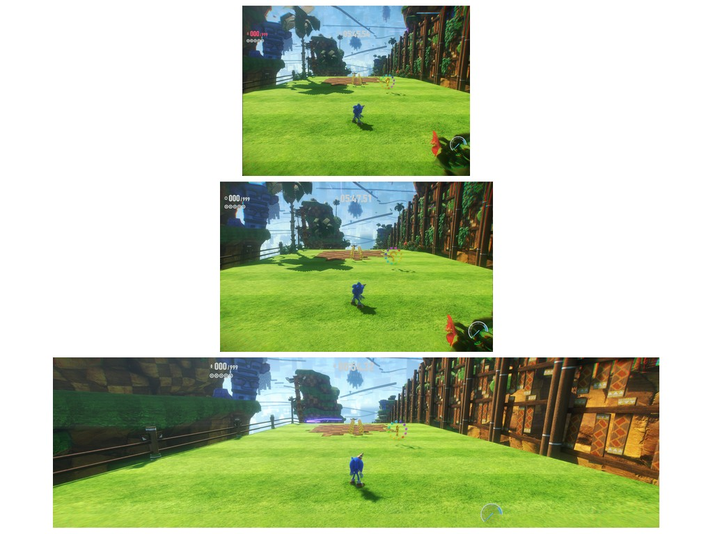

# Sonic Frontiers-Any-Aspect-Ratio

[](https://github.com/TLin-Y/SteamAnyAspectRatioMods) [](https://ko-fi.com/lin66961)



Runs the game at any aspect ratio without black bars. Narrower screens keep the 16:9 side view and show more above and below; wider screens show more at the sides. The HUD stays fully on screen.

## Install

Extract `SonicFrontiers_ARFix.asi`, `SonicFrontiers_ARFix.ini`, and `dinput8.dll` into the game folder (beside `SonicFrontiers.exe`).

## SteamOS / Winlator

Add the launch option:

```text
WINEDLLOVERRIDES="dinput8=n,b" %command%
```

## Settings

Pick your screen resolution in the game (Options > Graphics > Resolution), for example 1280 x 800 on the Steam Deck.

Edit `SonicFrontiers_ARFix.ini` and restart the game:

```ini
[FOV]
Multiplier = 1.0
```

`Multiplier` scales the camera field of view (0.5 to 2.0).
