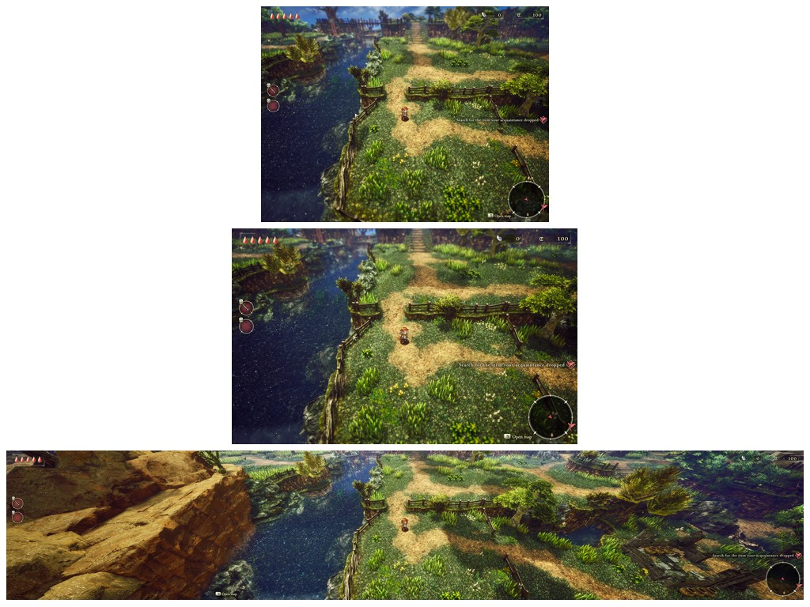

# The Adventures of Elliot: The Millennium Tales-Any-Aspect-Ratio

[](https://github.com/TLin-Y/SteamAnyAspectRatioMods) [](https://ko-fi.com/lin66961)



Runs the game at any aspect ratio, with an optional FOV multiplier. Works with the full game and the Prologue Demo.

## Install

Extract `Elliot_ARFix.asi`, `Elliot_ARFix.ini`, and `winhttp.dll` into `Elliot\Binaries\Win64` inside the game folder
(beside `Elliot-Win64-Shipping.exe`).

## SteamOS / Winlator

Add the launch option:

```text
WINEDLLOVERRIDES="winhttp=n,b" %command%
```

## Custom Aspect Ratio

Edit `Elliot_ARFix.ini` and restart the game:

```ini
[Resolution]
Width = 0
Height = 0

[FOV]
Multiplier = 1.0
```

`Width` and `Height` set the resolution. `0` uses your screen resolution (borderless fullscreen). Any other size, for example `1280` and `800`, runs the game in a window of that size.
The in-game resolution and window settings are overridden by the mod.
`Multiplier` scales the camera field of view (0.5 to 2.0).

Story scenes, the title screen and movies keep some of the game's own black bars.
