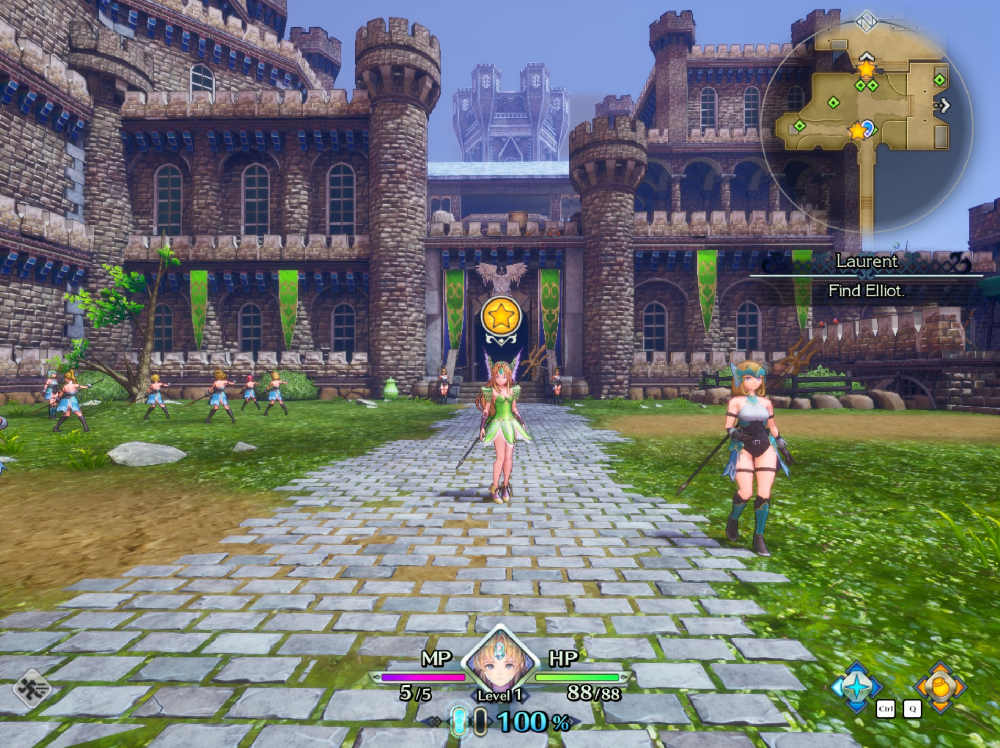

# Trials of Mana - Narrow Aspect Ratio Fix (WIP)

This work-in-progress patch supplements the [Steam community ultrawide workaround](https://steamcommunity.com/app/924980/discussions/0/2268068817146932077/). That guide changes a game executable byte for a particular 5120x1440 setup. This patch makes the target resolution and FOV byte configurable, with the goal of supporting narrower displays such as 16:10 handheld screens.



## Status

This is a work in progress. It has not been packaged as a release. The patch can set a custom window resolution and adjust the FOV byte, but it does not yet produce a clean result in every scene or runtime.

## Installation

Copy these three files into the game's `Trials of Mana\Trials of Mana\Binaries\Win64` folder:

- `dxgi.dll`
- `TrailsOfMana_ARFix.asi`
- `TrailsOfMana_ARFix.ini`

For a typical Steam installation, this is under:

`steamapps\common\Trials of Mana\Trials of Mana\Binaries\Win64`

The bundled `dxgi.dll` is the 64-bit Ultimate ASI Loader proxy. The game and mod files belong together in the `Win64` folder.

For SteamOS / Proton, open the game's Properties, then General > Launch Options, and add:

`WINEDLLOVERRIDES="dxgi=n,b" %command%`

In Winlator or another Wine frontend, configure the equivalent `dxgi=n,b` DLL override for the game/container.

## Configuration

Edit `TrailsOfMana_ARFix.ini` in the same folder as the game executable:

```ini
[Resolution]
TargetWidth = 1280
TargetHeight = 800
; 0E, 0A, 0B, 0C
FovHex = 0A
```

- `TargetWidth` and `TargetHeight` set the game window resolution. The default `1280x800` is 16:10, suitable for devices such as Steam Deck.
- `FovHex` selects the byte used by the FOV patch. The example/default is `0A`; other values shown in the file include `0E`, `0B`, and `0C`. Change it only if you know which FOV value you want to test.

## Known issues and limitations

- Some GUI elements are cropped.
- Black borders may still appear. If they do, reopen the in-game display settings and reselect the desired resolution and window mode.
- In Wine/Proton, using Ultimate ASI Loader (UUU) is inconvenient to set up; this does not mean the mod itself is incompatible with Wine/Proton.

No release package is provided while these issues remain.
