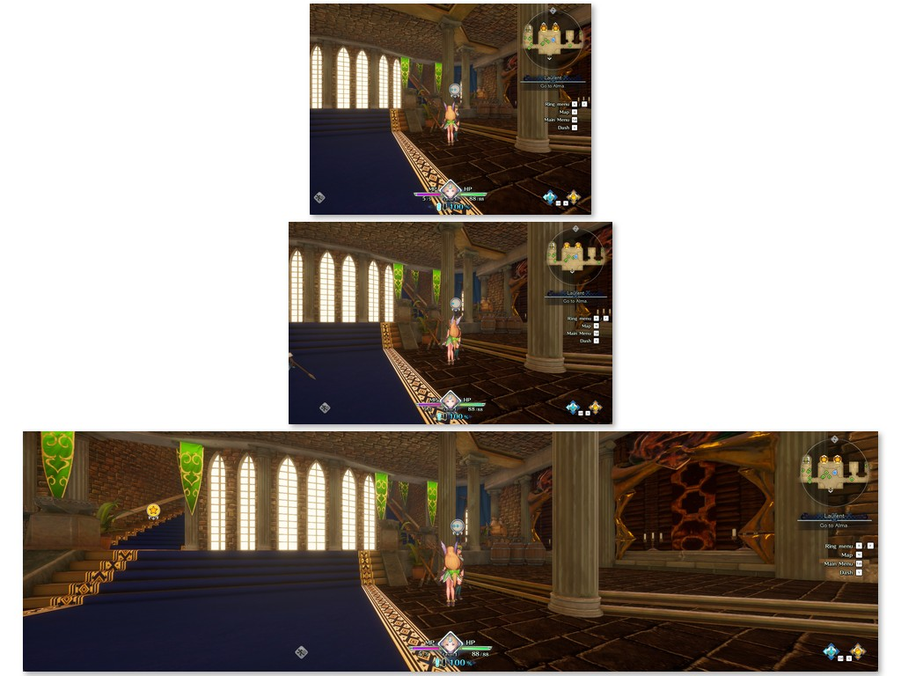

# Trials of Mana-Any-Aspect-Ratio

[](https://github.com/TLin-Y/SteamAnyAspectRatioMods) [](https://ko-fi.com/lin66961)

Runs the game at any aspect ratio without black bars in cutscenes, with an optional FOV multiplier and borderless window.

This mod started from the [Steam community ultrawide workaround](https://steamcommunity.com/app/924980/discussions/0/2268068817146932077/) and UUU (https://framedsc.com/GeneralGuides/universal_ue4_consoleunlocker.htm). That guide changes a game executable byte for a particular 5120x1440 setup. This mod needs no exe edit or UUU and supports any screen, including narrower displays such as 16:10 handheld screens.

## Install

Extract `TrialsOfMana_ARFix.asi`, `TrialsOfMana_ARFix.ini`, and `dxgi.dll` into `Trials of Mana\Trials of Mana\Binaries\Win64`
(beside `Trials of Mana-Win64-Shipping.exe`).

## SteamOS / Winlator

Add the launch option:

```text
WINEDLLOVERRIDES="dxgi=n,b" %command%
```

## Settings

Edit `TrialsOfMana_ARFix.ini` and restart the game:

```ini
[Resolution]
Width = 1280
Height = 800

[FOV]
Multiplier = 1.0

[Display]
Borderless = false
```

`Width` and `Height` set the game window size and aspect ratio (default 1280x800, 16:10). Set both to `0` to use the in-game resolution instead.
`Multiplier` scales the camera field of view (0.5 to 2.0), cutscenes included.
`Borderless = true` removes the title bar when `Width` and `Height` are `0`; a custom size is always borderless.

## Known issues

- Some GUI elements, such as the loading bar, may be cropped.

## Demo


