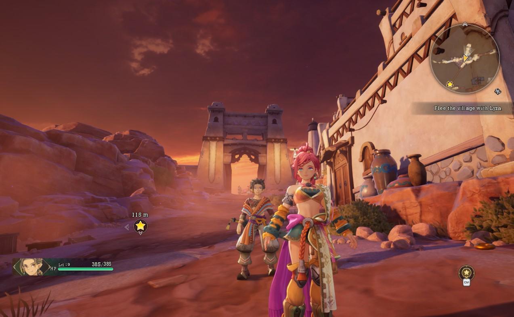
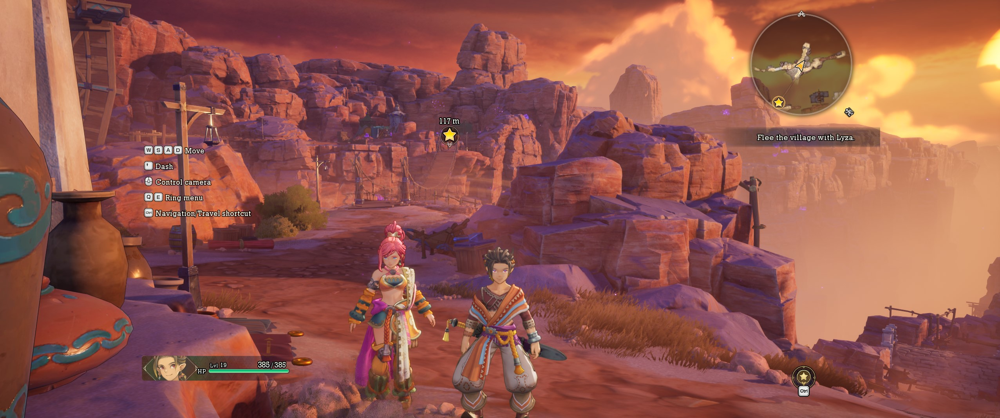

# Visions of Mana - Any Aspect Ratio and FOV

## 1. Install

Extract the ZIP into the game's `Visions.of.Mana\VisionsofMana\Binaries\Win64` folder.

## 2. Set resolution and FOV

Edit `VoM_ARFix.ini`. The default resolution is **1280x800 (16:10)**. Change `Width` and `Height` to the resolution you want. The mod also supports ultrawide resolutions.

`Multiplier` under `[FOV]` adjusts the FOV; `1.00` is the default. `EnableAR` and `EnableFOV` independently toggle the aspect-ratio and FOV fixes. Keep `[Resolution] Enable = true` to force a borderless window at the configured size.





## 3. Steam Deck / Proton

In the game's **Properties > General > Launch Options**, enter:

```text
WINEDLLOVERRIDES="dxgi=n,b" %command%
```

Windows does not need a launch option.
