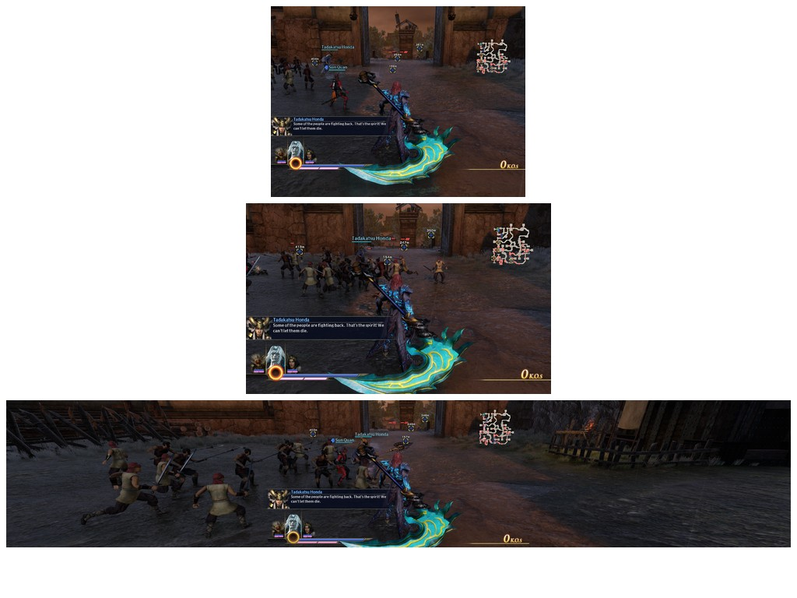

# WARRIORS-OROCHI-4-Ultimate-Any-Aspect-Ratio

 

Fills the screen at any aspect ratio. The HUD, menus and movies keep their 16:9 shape, and screens narrower than 16:9 get extra view above and below.

# Install
Extract the mod files directly into your Steam game.exe folder.

In the game's graphics settings, pick the last resolution (it shows your screen size, e.g. 1280x800 on Steam Deck). Fullscreen and windowed both work.

# For SteamOS / Winlator (Wine Users)
For Steam Deck / SteamOS, open the game's Properties, then General > Launch Options, and use:
`WINEDLLOVERRIDES="dinput8=n,b" %command%`

For Winlator / Wine, add this environment variable to the game or container settings:
Name: WINEDLLOVERRIDES
Value: dinput8=n,b

# Custom Aspect Ratio
Open WO4U_ARFix.ini with any text editor. Set TargetWidth and TargetHeight to your screen ratio (e.g., 4:3, 16:10, 21:9).

FOVScale changes the field of view: 1.0 is the normal view, and lower values show more.

Under [Custom Resolution], Width and Height 0 use your screen size.
