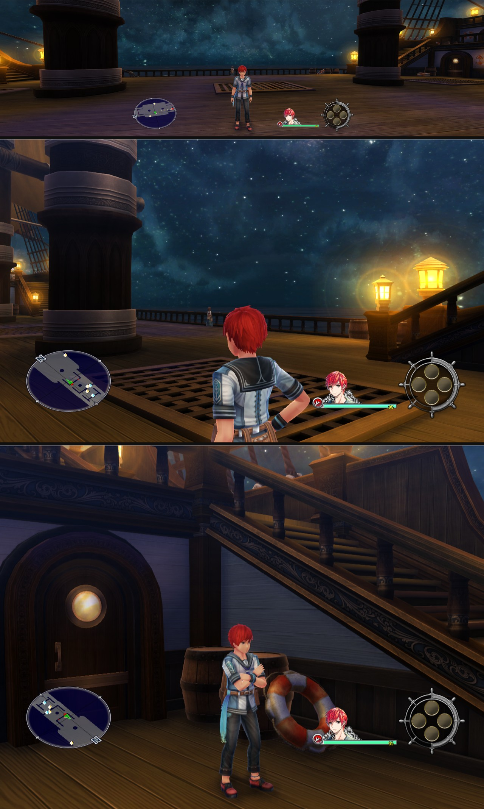

# Ys-VIII-Lacrimosa-of-DANA-Any-Aspect-Ratio

 

## Install

Extract the files into the game folder containing `ys8.exe`.

## SteamOS / Winlator

Set the launch option or Wine environment variable to:

`WINEDLLOVERRIDES="dinput8=n,b" %command%`

## Custom Aspect Ratio

Edit `Ys8_AspectPatch.ini` and set `Width` and `Height` to your desired resolution. Select the same resolution in the game; the mod does not change the game's resolution. The default resolution is 1280x800 (16:10).

The 3D view renders at your full resolution and fills the screen. The HUD and menus stay 16:9 and centered.

`CustomAR` is an optional manual aspect-ratio override. Leave `SharedProjection = false`; that experimental option may distort the UI.

The gameplay patch validates the supported game executable before making changes. Check `Ys8_AspectPatch.log` if a patch is not applied.

## Screenshots

